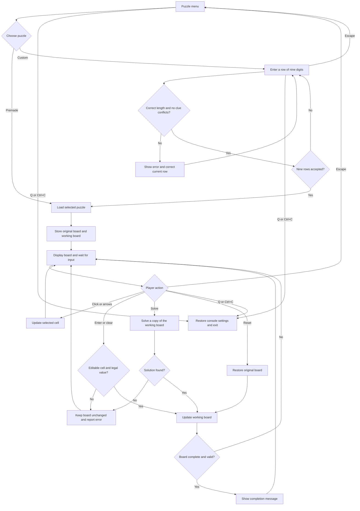
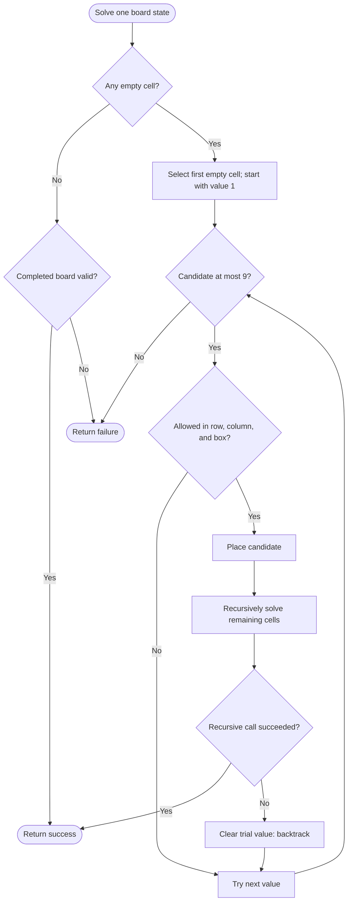

# Product Requirements Document: Terminal Sudoku

## 1. Project overview

Terminal Sudoku is a small C++20 application for playing and solving standard 9x9 Sudoku. Users can choose a premade puzzle, enter a custom puzzle, fill cells manually, or ask the program to solve the current board.

This document describes the implemented project in `main.cpp`. It is intended for users, students explaining the program, and developers maintaining it.

| Item | Current implementation |
| --- | --- |
| Interface | Terminal only; no GUI or browser |
| Language | C++20 |
| Structure | One source file with ordinary functions |
| Dependencies | C++ standard library; Windows console APIs or Linux POSIX terminal APIs and ANSI sequences |
| Board | 9 rows, 9 columns, nine 3x3 boxes |
| Premade puzzles | Nine fixed puzzles: Easy 1-3, Medium 1-3, Hard 1-3 |
| Solver | Recursive backtracking |
| Storage | In memory only; no saved progress |
| Network | Not required |

The goal is to make Sudoku easy to play in a terminal while keeping the implementation understandable. Difficulty labels are approximate, not calculated ratings.

## 2. Launch modes

| Command | Behavior |
| --- | --- |
| `sudoku.exe` | Open the interactive menu when terminal initialization succeeds on Windows or Linux; otherwise use text mode |
| `sudoku.exe --text` | Read a custom puzzle and use typed commands |
| `sudoku.exe --self-test` | Run assert-based checks and exit; requires a build without `NDEBUG` |
| Unsupported arguments | Print usage and exit with an error |

Interactive controls support Windows consoles and Linux ANSI-compatible terminals. Redirected input/output uses text mode. On Linux, a missing TERM value or TERM=dumb also selects text mode. A console error after interactive mode has started ends that session and displays a message to restart with `--text`; it does not automatically transfer the game to text mode.

### Startup flowchart

```mermaid
flowchart TD
    A([Start]) --> B{Arguments}
    B -->|--self-test| C[Run checks if assertions are enabled]
    C --> Z([Exit])
    B -->|Unsupported| D[Print usage error]
    D --> Z
    B -->|--text| T[Start text mode]
    B -->|No arguments| W{Interactive terminal initialization succeeds?}
    W -->|Yes| I[Start interactive puzzle menu]
    W -->|No| T
    I --> J[Interactive session]
    J --> K[Restore console settings on exit]
    K --> Z
    T --> U[Read nine valid rows]
    U --> V[Display board and process typed commands]
    V -->|Quit or end of input| Z
    U -->|End of input| Z
```



## 3. User flow and controls

### Interactive terminal mode

1. Start the program in a console at least 76 columns wide and 24 rows high. A smaller window displays a resize message; game input waits until the window is large enough. Quit remains available.
2. Choose a puzzle using Up/Down and Enter, or click a menu item. All nine puzzles are immediately available; there is no unlocking system.
3. For Custom puzzle, type nine digits per row and press Enter. Use `0` for empty cells and Backspace to correct the current row. A row with conflicting clues is rejected. Previously accepted rows cannot be edited on this screen; Escape returns to the menu to start over.
4. The program keeps an original board for clue protection and a working board for play. The selected cell begins at row 1, column 1.
5. Click a cell or move with the arrow keys, then enter a number. The board redraws in place after input.
6. Continue manually, solve automatically, reset, return to the menu, or quit. Completion displays a message and leaves controls available.

| Input during play | Result |
| --- | --- |
| Left mouse click | Select a cell; clicks on borders or outside cells do nothing |
| Arrow keys | Move the selection; stop at the board edges |
| `1-9` | Enter or replace a value in an editable cell |
| `0`, Backspace, Delete | Clear an editable cell |
| `S` | Solve the current board, including player entries |
| `R` | Restore the original puzzle |
| Escape | Return to the puzzle menu and discard progress |
| `Q`, Ctrl+C | Exit the interactive session |

The selected cell is highlighted. Original clues are white, and editable entries are cyan when not selected. The screen shows selected coordinates, controls, and a status or completion message. On Windows, the program temporarily disables Quick Edit so clicks reach the game and restores saved console settings on exit. On Linux, it enables immediate key input, draws in the alternate screen, and requests SGR mouse events. On normal exit, including Q or Ctrl+C, it restores input settings, disables mouse reporting, shows the cursor, and returns to the previous screen.

### Interactive game flowchart



The diagram shows normal gameplay. Resize events trigger a redraw. Unrecognized keys are ignored. Console input/output failures leave the interactive loop and report an error.

### Text mode

Text mode starts directly with custom puzzle entry; it does not offer the premade puzzle menu. Enter nine rows of exactly nine digits without spaces. Malformed or conflicting rows are retried. After loading the puzzle, enter one command per line.

| Command | Example | Result |
| --- | --- | --- |
| `set row col value` | `set 1 3 4` | Put 4 in row 1, column 3 |
| `clear row col` | `clear 1 3` | Erase a player entry |
| `solve` | `solve` | Solve the working board |
| `reset` | `reset` | Restore the original puzzle |
| `help` | `help` | Print available commands |
| `quit` | `quit` | Exit |

Coordinates and entered values are 1-9. Unknown or malformed commands leave the board unchanged. Successful edits, reset, and solving print the board again. End of input exits cleanly. To enter a different puzzle in text mode, restart the program.

## 4. Validation and state rules

- Store the board as a fixed 9x9 array of integers; `0` means empty and `1-9` are values.
- A nonzero value must not repeat in its row, column, or 3x3 box.
- Original nonzero clues cannot be changed or cleared. Player entries can be replaced or erased.
- Validate custom rows before accepting them. Validate manual moves before changing the working board.
- A board is complete only when every cell is filled and all constraints pass.
- Local validity does not prove solvability. An accepted player move can still lead to a puzzle with no solution.
- Reset copies the original board back into the working board. No undo history or saved session exists.
- Premade puzzles have exactly one solution, checked by self-tests. Custom puzzles are not checked for uniqueness during play.

## 5. Automatic solving flow

When the user requests Solve, the program copies the current board. The solver scans rows from top to bottom and columns from left to right to find the first empty cell. It tries values 1 through 9 in order, skipping values that conflict with the row, column, or box.

After placing a legal value, it calls itself to solve the remaining cells. If that branch fails, it clears the trial value and tries the next one. This is backtracking: undoing a guess when it cannot lead to a complete solution.

If no empty cells remain, the solver validates the completed board and returns success or failure. If every candidate fails, it returns failure to the previous call. The first successful solution replaces the working board; failure leaves the user's board unchanged.

### Backtracking flowchart



The solver runs synchronously, so interactive input waits while it searches. It returns the first solution and does not rate difficulty or count solutions during gameplay. A separate test-only counter stops at two solutions to verify premade puzzle uniqueness.

## 6. Implementation map

All application logic lives in `main.cpp`; these are functions, not separate services or modules.

| Functions or data | Responsibility |
| --- | --- |
| `Board`, `puzzles`, `puzzleBoard` | Store board values and load fixed puzzles |
| `allowed`, `valid`, `complete` | Check placement constraints and completion |
| `move` | Apply a validated edit while protecting original clues |
| `solve` | Find the first solution using recursive backtracking |
| `interactive` | Run shared menu, custom-entry, and game screens with platform-specific terminal input/output |
| `cellX`, `cellY`, `hitCell`, `shifted` | Match cell rendering to mouse clicks and bound arrow movement |
| `readBoard`, `print`, `command` | Handle text input, rendering, and commands |
| `solutionCount`, `selfTest` | Verify correctness and built-in puzzle uniqueness |
| `decodeInput`, `terminalInput`, `readByte` | Decode terminal keys and mouse sequences; read Linux terminal bytes with timeouts |
| `main` | Select launch mode and manage the text-mode loop |

Deliverables are `main.cpp`, build and usage instructions in `README.md`, and this PRD. `sudoku.exe` and `main.obj` are local build outputs.

## 7. Verification and acceptance

Run `sudoku.exe --self-test` after compiling with assertions enabled. Existing automated checks cover:

- Validity, solvability, uniqueness, and clue preservation for all nine premade puzzles.
- Completed boards, duplicate clues, invalid custom input, and end of input.
- Malformed commands, protected clues, conflicting moves, clearing, and reset.
- A locally valid but unsolvable board, including preservation after failed solving.
- Selection movement bounds and mouse hit testing for cell areas and borders.

The previous implementation verification compiled with MSVC warnings enabled without warnings. Self-tests passed. Terminal checks exercised keyboard entry, simulated mouse selection, puzzle switching, custom entry, reset, solving, and exit. Explicit text mode and automatic redirected-input mode produced matching results.

Physical mouse use and actual window resizing have not been manually verified. Linux terminal sequence decoding is covered by self-tests. A native Linux build and interactive session have not been verified here because local WSL access is denied; macOS has not been verified either. Those checks remain separate from the automated assertions.

## 8. Current limits

Only standard 9x9 Sudoku is supported. Mouse and immediate-key controls require a compatible Windows console or Linux terminal emulator. Linux uses POSIX termios and ANSI/SGR sequences without external libraries; plain text mode remains available. Difficulty labels are approximate. Basic backtracking may take longer on difficult custom inputs; there is no search timeout or cancellation while solving.

There is no puzzle generation, saving/loading, progress tracking, hints, undo/redo, animation, benchmarking, alternate solver, or external library. Returning to the menu or exiting discards progress.

## 9. Linux build and execution

Transfer main.cpp to Linux and compile it there; Windows .exe and .obj outputs are not Linux binaries.

```bash
g++ -std=c++20 -Wall -Wextra -pedantic -O2 main.cpp -o sudoku
./sudoku --self-test
./sudoku
```

Use ./sudoku --text when an interactive terminal is unavailable. Linux input waits up to 100 ms after Escape to distinguish a standalone Escape key from an arrow or mouse sequence. The screen size is checked periodically so resizing is handled without waiting for a key. Mouse clicks require an SGR-compatible terminal. There is no guarantee of terminal cleanup after forced process termination.
